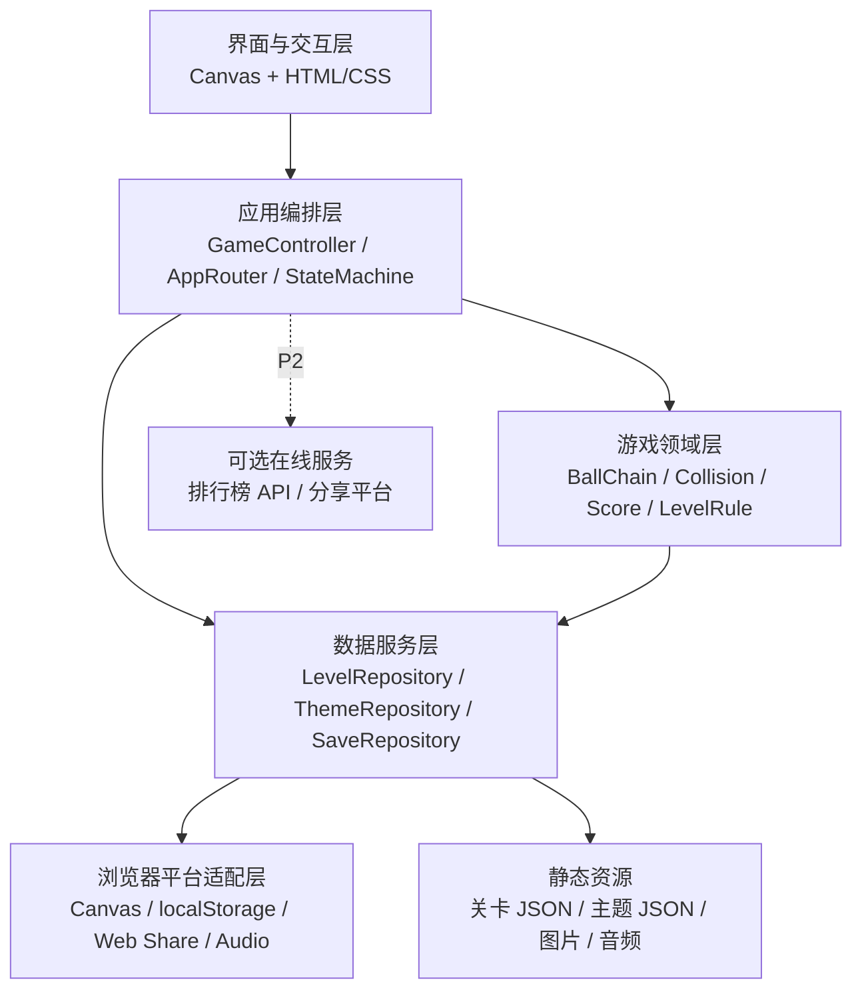
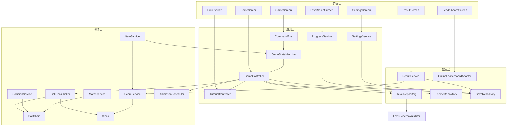
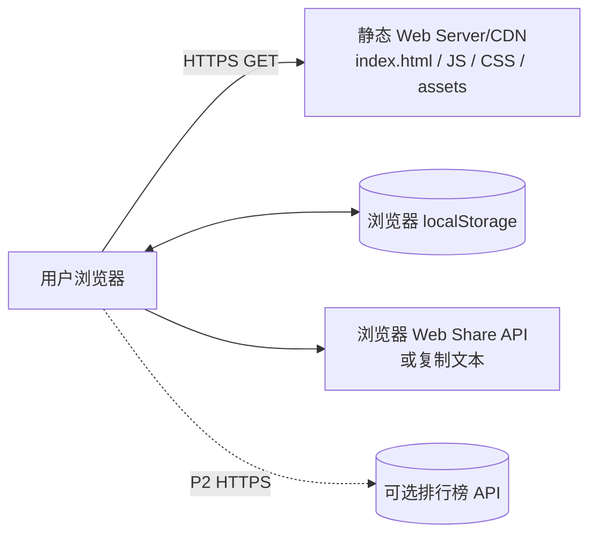
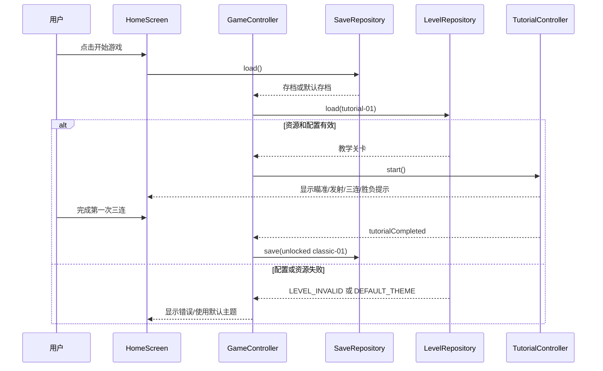
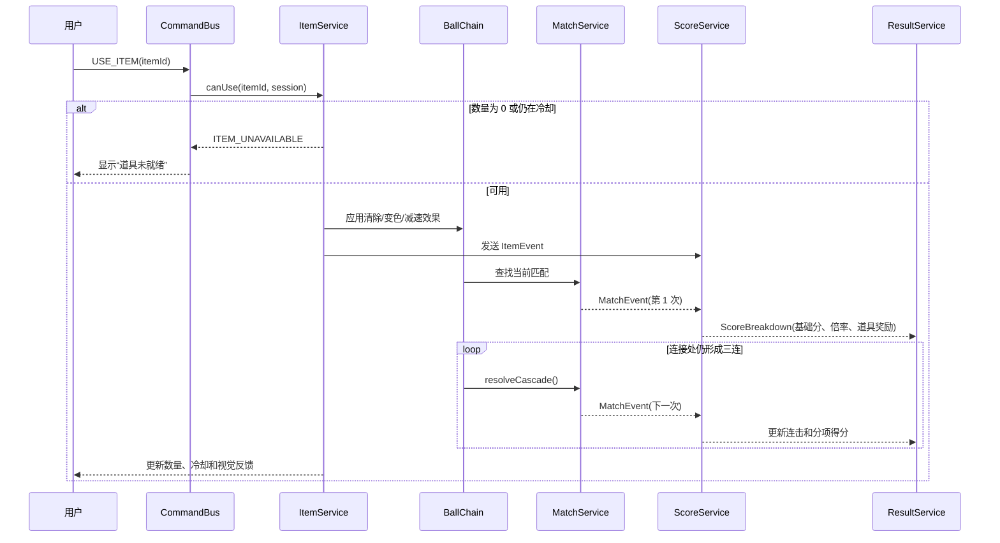
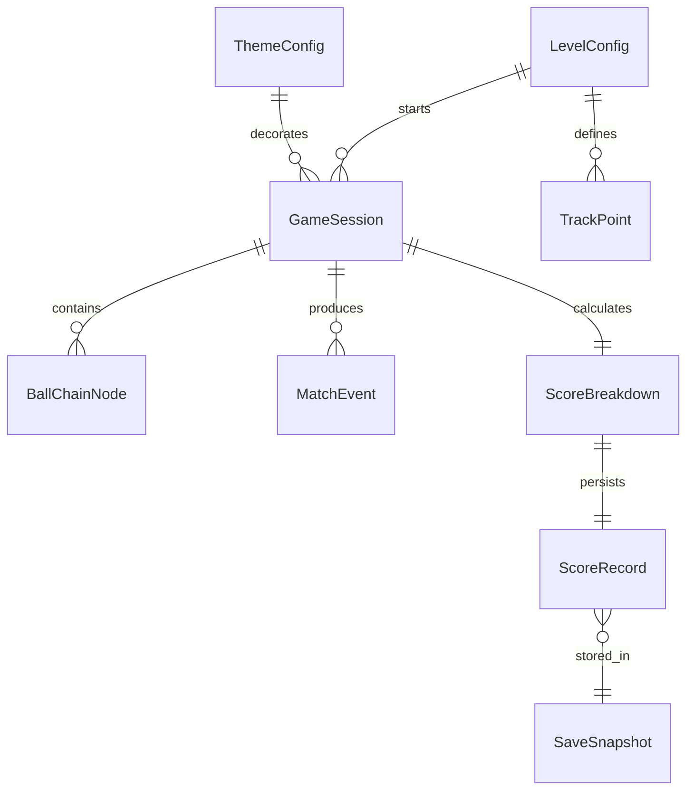

# 《热梗祖玛》软件设计文档

## 1. 文档信息

| 项目 | 内容 |
|---|---|
| 项目名称 | 热梗祖玛 |
| 文档版本 | D1.2 |
| 设计对象 | 轻量级单机网页益智消除游戏 |
| 需求基线 | 实验 1《热梗祖玛_需求分析文档.md》V2.2 |
| 目标平台 | Windows 10/11，Chrome/Edge 最新两个稳定版本；桌面端优先 |
| 部署方式 | 静态网页资源部署；核心游戏在浏览器本地运行 |
| 设计范围 | 教学模式、经典模式、热梗挑战模式、主题包、本地存档、成绩结算和可选在线服务接口 |
| 非目标 | 实时联机、账号体系、云同步、用户上传主题、付费系统 |

## 2. 设计目标与需求基线

### 2.1 设计目标

1. 用稳定的祖玛核心玩法服务怀旧玩家，用可替换主题包吸引新玩家。
2. 采用客户端本地优先架构，使核心关卡在无网络时仍可运行。
3. 将关卡、主题、得分、存档和渲染解耦，使课程项目可以在有限周期内实现并继续扩展。
4. 让每项关键设计都能回溯到实验 1 的 G、FR、NFR、AC 或 TC 编号。

### 2.2 需求文档引用

需求基线与实验 1 需求修正已分别移至以下独立文件：

- [需求基线说明](热梗祖玛_需求基线说明.md)
- [需求变更说明](热梗祖玛_需求变更说明.md)

本设计文档继续使用实验 1 V2.2 的 G、FR、NFR、AC、TC 和 C 编号；设计中引用的编号均以两份独立说明和实验 1 原文为准。

## 3. 总体架构设计

### 3.1 架构风格

系统采用“浏览器端单页应用 + 分层模块 + 数据驱动内容”的架构。核心玩法不依赖服务器，静态资源可以由任意静态 Web Server 提供；页面加载后由浏览器执行渲染、输入处理、碰撞、计分和存档。



### 3.2 分层职责

| 层 | 主要职责 | 不应承担的职责 |
|---|---|---|
| 界面与交互层 | 展示页面、接收鼠标/触摸输入、显示提示和结算结果 | 不直接修改球链或分数 |
| 应用编排层 | 管理页面路由、游戏状态、命令分发、暂停和恢复 | 不实现具体碰撞公式 |
| 游戏领域层 | 球链、轨道、碰撞、消除、连锁、计分、胜负判断 | 不读写 DOM 或 localStorage |
| 数据服务层 | 读取关卡/主题、保存和加载存档、排行和分享适配 | 不决定游戏规则 |
| 浏览器适配层 | 封装 Canvas、音频、存储、分享和网络能力 | 不包含产品业务规则 |

### 3.3 组件划分

| 组件 | 职责 | 依赖 |
|---|---|---|
| `HomeScreen` | 首页、模式入口、主题预览 | `SaveRepository`、`ThemeRepository` |
| `LevelSelectScreen` | 展示关卡、星级和解锁状态 | `ProgressService` |
| `GameScreen` | Canvas、目标、当前球/下一球、道具和暂停控件 | `GameController`、`Renderer` |
| `TutorialController` | 教学步骤和一次性提示 | `GameStateMachine`、`HintOverlay` |
| `GameController` | 编排一局游戏的开始、暂停、成功和失败 | 领域服务、渲染器 |
| `AppRouter` | 在首页、关卡、游戏、结算、设置和排行页面间切换 | 各页面组件、`GameController` |
| `GameStateMachine` | 管理 INIT/READY/PLAYING/PAUSED/SUCCESS/FAILED/RESULT | `GameController` |
| `InputController` | 鼠标、触摸、键盘和按钮输入归一化 | `CommandBus` |
| `BallChain` | 球链节点、插入、移动、连接和删除 | 轨道模型 |
| `CollisionService` | 发射球与球链、轨道边界的碰撞处理 | `BallChain`、`LevelRule` |
| `LevelRule` | 提供关卡目标、失败条件和模式规则的只读策略 | `LevelConfig` |
| `MatchService` | 三连判定和连锁队列 | `BallChain` |
| `ScoreService` | 基础分、倍率、时间奖励、道具奖励 | 关卡配置、会话状态 |
| `ItemService` | 清除器、变色器、减速器的获取和使用 | `ScoreService`、`GameStateMachine` |
| `Renderer` | Canvas 绘制、动画帧和特效 | 浏览器 Canvas |
| `LevelRepository` | 加载并校验关卡 JSON | 静态资源 |
| `ThemeRepository` | 加载主题、素材回退和来源信息 | 静态资源 |
| `SaveRepository` | localStorage 存档、版本迁移和损坏回退 | 浏览器存储 |
| `ResultService` | 结算、星级、本地排行、分享卡片 | `ScoreService`、`SaveRepository` |
| `ProgressService` | 关卡解锁、已完成状态和星级读取 | `SaveRepository` |
| `SettingsService` | 音频、动画、震动、辅助瞄准设置 | `SaveRepository` |
| `LeaderboardScreen` | 展示本地排行和 P2 在线排行状态 | `ResultService`、`OnlineLeaderboardAdapter` |
| `SettingsScreen` | 设置开关、清除存档确认 | `SettingsService`、`SaveRepository` |
| `ResultScreen` | 展示 ScoreBreakdown、星级、分享和下一关 | `ResultService` |
| `HintOverlay` | 教学和新机制提示，不遮挡关键游戏对象 | `TutorialController`、`Renderer` |
| `CommandBus` | 缓冲并按顺序派发用户命令 | `InputController`、`GameStateMachine` |
| `Clock` | 提供可暂停的游戏时间和倒计时 | `GameController`、`ScoreService` |
| `BallChainTicker` | 按帧推进球链位置 | `Clock`、`BallChain` |
| `AnimationScheduler` | 管理消除、连锁和特效动画 | `Clock`、`Renderer` |
| `LevelSchemaValidator` | 校验关卡配置字段和取值范围 | `LevelRepository` |
| `OnlineLeaderboardAdapter` | 封装 P2 排行榜请求、超时和限流 | `LeaderboardScreen`、网络适配器 |

### 3.4 依赖关系约束

- `Renderer` 只能读取领域状态，不得修改领域对象。
- `CollisionService` 不调用 `SaveRepository`；存档由 `GameController` 在状态转换后统一触发。
- `ScoreService` 不读取界面控件，所有输入通过领域命令传递。
- `ThemeRepository` 失败时只返回默认主题和诊断信息，不抛出会阻断游戏的未处理异常。
- P2 在线排行只能由 `OnlineLeaderboardAdapter` 访问，核心模块不得直接依赖网络。

### 3.5 组件级静态依赖图



箭头表示调用或数据依赖；领域层不依赖界面层。`OnlineLeaderboardAdapter` 是唯一允许访问在线排行的组件，`ProgressService` 和 `SettingsService` 通过 `SaveRepository` 读写本地数据。

### 3.6 部署与运行视图



部署只需要静态资源服务器即可运行 P0/P1 核心能力。服务器不可用时，已加载的本地关卡不受影响；在线排行榜仅作为 P2 增强能力。

### 3.7 浏览器主循环与帧内预算

系统使用单浏览器主线程，不创建游戏工作线程。`requestAnimationFrame` 每帧执行一次，输入命令进入 `CommandBus`，再由应用层按固定顺序消费：

```text
采集输入 → 命令入队 → 状态机校验并消费命令 → 领域逻辑更新
→ 球链/计时更新 → 匹配与计分事件 → UI 状态投影 → Canvas 渲染 → 必要时触发存档
```

| 帧内阶段 | 目标预算 | 约束 |
|---|---:|---|
| 输入采集与命令分发 | ≤1 ms | 同一帧最多消费 1 个 `FIRE_BALL`、1 个 `USE_ITEM` 和 1 个瞄准更新 |
| 状态机与领域更新 | ≤4 ms | 碰撞、匹配和计分不得直接操作 DOM |
| 球链与动画更新 | ≤5 ms | 超过预算时降低粒子特效，不跳过球链和胜负判断 |
| Canvas 渲染 | ≤8 ms | 复用绘制对象，球和特效数量受关卡上限控制 |
| 帧后任务 | ≤2 ms | 存档使用状态转换后的快照；网络请求不得阻塞主循环 |

目标是 60 FPS（约 16.67 ms/帧）；当一帧超过 24 ms 连续 3 帧时触发低性能档位，关闭粒子和屏幕震动但保留球链、碰撞和结算。命令队列最多保留 8 个命令，超过后丢弃最旧的 `AIM` 命令，永不丢弃暂停、重试和返回首页命令。

## 4. 模块设计

### 4.1 游戏状态机

状态集合与《热梗祖玛_需求分析文档.md》“状态模型与关键流程”章节一致：`INIT → TUTORIAL/READY → PLAYING ↔ PAUSED → SUCCESS/FAILED → RESULT`。

| 状态 | 允许命令 | 禁止命令 | 关键副作用 |
|---|---|---|---|
| INIT | `START_GAME`、`OPEN_SETTINGS` | `FIRE_BALL`、`USE_ITEM` | 加载存档和默认主题 |
| TUTORIAL | `AIM`、`FIRE_BALL`、`PAUSE`、`RETRY` | 提交排行榜 | 更新教学步骤，不记录排行 |
| READY | `AIM`、`FIRE_BALL`、`PAUSE` | `USE_ITEM`（未开始时） | 创建关卡会话 |
| PLAYING | `AIM`、`FIRE_BALL`、`USE_ITEM`、`PAUSE` | `NEXT_LEVEL` | 推进球链和计时 |
| PAUSED | `RESUME`、`RESTART`、`HOME` | `FIRE_BALL`、`USE_ITEM` | 冻结球链、计时和动画 |
| SUCCESS | `VIEW_RESULT`、`NEXT_LEVEL`、`RETRY` | `FIRE_BALL` | 解锁下一关并保存成绩 |
| FAILED | `RETRY`、`HOME`、`VIEW_RESULT` | `FIRE_BALL` | 停止会话，不提交无效成绩 |
| RESULT | `SHARE`、`RETRY`、`NEXT_LEVEL`、`HOME` | `FIRE_BALL` | 生成结算结果和分享数据 |

### 4.2 关卡模块

关卡使用 JSON 配置，程序只负责通用规则。加载时由 `LevelSchemaValidator` 校验：`levelId` 唯一、轨道点不少于 2 个、球序列长度为 3—120、速度为 10—180、星级阈值单调递增。校验失败时关卡不可进入，并显示可理解的错误。

关卡解锁由 `ProgressService` 管理：教学关完成后解锁经典第 1 关；第 n 个正式关卡完成后解锁第 n+1 个正式关卡；解锁状态写入存档，不以服务器返回为准。

### 4.3 球链与碰撞模块

`BallChain` 使用有序节点集合表示球链，节点至少包含 `ballId`、`patternId`、`distanceOnPath`、`state`。轨道使用折线或曲线抽象为“路径距离”，球链移动只改变路径距离，不直接依赖屏幕坐标。

碰撞流程：

1. 发射球沿方向向量移动。
2. 检测与球链节点的最近碰撞点。
3. 若命中合法插槽，插入球链并锁定当前发射命令。
4. 若命中边界，按 FR-17 反弹一次；仍无合法位置则插入最近合法位置。
5. `MatchService` 查找连续相同图案段，满足 3 个或以上时生成消除事件。
6. 球链合并后再次检查连接处，产生连锁事件，直到没有新匹配。

### 4.4 计分与道具模块

`ScoreService` 接收不可变的 `MatchEvent`、`ComboState`、`TimeState` 和 `ItemEvent`，输出新的 `ScoreBreakdown`，不直接修改 UI。

```text
基础分 = 30 + max(0, 消除球数 - 3) × 10
本次消除分 = 基础分 × 当前倍率
连击倍率：每局开始时为 1；首次消除按 1 倍计算；下一次消除在小于等于 2 秒内发生时倍率加 1，最高为 5；超过 2 秒重置为 1。
剩余时间奖励 = floor(剩余秒数 / 5) × 10
道具奖励 = 清除器成功生效次数 × 50；变色器和减速器固定分值为 0
总分 = 消除分总和 + 剩余时间奖励 + 道具奖励 + 关卡固定奖励
```

清除器、变色器和减速器只在挑战模式启用。道具的获取、使用、冷却和视觉反馈由 `ItemService` 管理；任何道具不得调用支付接口。

| 道具 | 获取条件 | 效果 | 冷却 | 道具奖励 |
|---|---|---|---:|---:|
| 清除器 | 累计消除 10 个球，单关最多 2 个 | 移除指向方向最近的连续 3 个球 | 8 秒 | +50 分；被移除球仍按基础消除规则计分 |
| 变色器 | 连击倍率首次达到 3 倍，单关最多 1 个 | 将下一发射球改为玩家选择的已有图案 | 5 秒 | 0 分；后续正常消除计分 |
| 减速器 | 本关累计存活 60 秒，单关最多 1 个 | 球链速度降低 30%，持续 5 秒 | 12 秒 | 0 分；只改变速度 |

道具数量为 0、冷却未结束或效果条件不满足时，`ItemService.use()` 返回 `ITEM_UNAVAILABLE`，不扣数量、不启动冷却、不改变分数。

### 4.5 存档模块

`SaveRepository` 负责四类操作：`load()`、`save(snapshot)`、`migrate(oldVersion)`、`clearAfterConfirm()`。存档只保存进度、成绩、设置和最近会话，不保存素材二进制和敏感个人信息。

读取顺序：读取字符串 → JSON 解析 → schema 校验 → 版本迁移 → 返回快照。任何一步失败都创建默认存档并返回 `SAVE_CORRUPTED` 诊断码，不能让页面白屏。

## 5. 关键流程设计

### 5.1 首次进入与教学流程



### 5.2 一次发射、消除与连锁

正常路径：输入控制器发送 `FIRE_BALL` → 状态机确认处于 READY/PLAYING → 碰撞模块计算插入 → 匹配模块产生 `MatchEvent` → 计分模块计算 → 球链合并 → 检查连锁 → 渲染器播放动画。

分支与异常路径：

- 正在发射动画：忽略重复 `FIRE_BALL`，不生成第二个球。
- 未命中球链但命中边界：执行 FR-17 默认反弹规则。
- 形成三连：执行消除和连锁。
- 未形成三连：球链继续移动，连击计时器按规则处理。
- 球链到达终点：优先于普通发射结果进入 FAILED，停止发射并不计入未完成动画。
- 领域计算异常：停止当前局，保留已解锁进度，记录诊断码并显示“本局计算异常，成绩未计入排行榜”；本局不写入本地最高分，提供重试。

### 5.3 暂停、失焦与恢复

用户点击暂停或页面进入后台 → `GameStateMachine` 进入 PAUSED → `Clock`、`BallChainTicker` 和 `AnimationScheduler` 停止 → 保存最近会话 → 显示继续/重开/返回首页。

若用户点击继续，校验当前关卡仍可用后恢复 PLAYING；若资源不可用，进入 FAILED 并保留进度。PAUSED 状态不得接受发射和道具命令，对应 FR-43、TC-05。

### 5.4 主题加载失败与回退

`ThemeRepository.load(themeId)` 先读取主题配置，再并行加载资源。任一非关键资源失败时使用默认资源并记录警告；主题配置解析失败时整体回退 `default-theme`，向界面返回 `THEME_FALLBACK`，但不阻断关卡。

### 5.5 结算与分享

关卡成功或失败 → `ResultService` 汇总分数 → 计算星级 → 写入本地最高分和最近结果 → 生成 `SharePayload` → 尝试 Web Share → 失败则生成复制文本。分享数据不包含真实姓名、手机号或存档原文。

### 5.6 挑战模式道具与连锁结算



| 分支 | 判定 | 处理 | 成绩影响 |
|---|---|---|---|
| 道具数量为 0 | `count == 0` | 返回 `ITEM_UNAVAILABLE`，不改变球链 | 不加分、不进入冷却 |
| 道具冷却中 | `cooldownMs > 0` | 忽略命令并提示剩余秒数 | 不加分 |
| 清除器生效 | 清除指定球段成功 | 产生 `ItemEvent` 和匹配事件 | 加入固定道具奖励，并按消除规则计分 |
| 变色器生效 | 发射球 patternId 改变成功 | 更新当前发射球 | 只在成功匹配后获得道具奖励 |
| 减速器生效 | 球链速度降低成功 | 设置临时效果和结束时间 | 固定道具奖励按 FR-25 处理 |
| 连锁超过 5 次 | 倍率已达到 5 | 后续消除继续执行，倍率保持 5 | 基础分继续累计，倍率不再增长 |
| 领域计算异常 | 分数不满足不变量 | 终止当前局并显示异常提示 | 不进入本地排行、不提交在线排行，已解锁进度保留 |

### 5.7 同时触发与并发边界

| 同时事件 | 判定优先级 | 处理结果 |
|---|---:|---|
| 球链到终点 + 发射球正在飞行 | 1. 失败判定；2. 发射结果 | 立即 FAILED；飞行球不计分、不进入排行 |
| 倒计时归零 + 球链未到终点 | 1. 倒计时失败 | 立即 FAILED；已经完成的消除保留在当前会话，但不再接受输入 |
| 倒计时归零 + 同一帧完成关卡目标 | 1. 领域事件时间戳；2. 目标完成 | 先完成目标事件则 SUCCESS，否则 FAILED；同一时间戳以失败优先，避免超时获胜 |
| 消除动画 + 用户再次发射 | 1. 动画锁；2. 发射命令 | 丢弃重复发射命令，不排队生成第二个球 |
| 暂停 + 道具使用 | 1. 状态转换；2. 道具命令 | 进入 PAUSED，道具命令返回 `INVALID_STATE_COMMAND` |
| 结算保存 + 页面关闭 | 1. 结算快照；2. 页面卸载 | 先写入一次完整快照；写入失败则显示未持久化提示 |

## 6. 接口设计

### 6.1 模块内部接口

内部接口使用 TypeScript 风格类型表示，调用方不得直接修改返回对象。

```ts
type GameCommand =
  | { type: 'AIM'; x: number; y: number }
  | { type: 'FIRE_BALL' }
  | { type: 'PAUSE' }
  | { type: 'RESUME' }
  | { type: 'USE_ITEM'; itemId: 'clear' | 'color' | 'slow' }
  | { type: 'RETRY' }
  | { type: 'HOME' };

interface GameStateMachine {
  dispatch(command: GameCommand): Result<void, GameError>;
  getState(): Readonly<GameSessionState>;
}

interface CollisionService {
  resolveShot(input: ShotInput, level: LevelConfig): CollisionResult;
}

interface ScoreService {
  applyMatch(event: MatchEvent, context: ScoreContext): ScoreBreakdown;
}

interface SaveRepository {
  load(): Result<SaveSnapshot, SaveError>;
  save(snapshot: SaveSnapshot): Result<void, SaveError>;
  clearAfterConfirm(): Result<void, SaveError>;
}
```

错误统一返回 `Result<T,E>`，不得用未处理异常跨模块传播。`E` 至少包含 `code`、`messageForUser`、`detailForLog` 和 `recoverable`。

### 6.1.1 其他核心服务接口

```ts
interface LevelRepository {
  load(levelId: string): Promise<Result<LevelConfig, LevelError>>;
  list(mode: 'tutorial' | 'classic' | 'challenge'): Promise<LevelSummary[]>;
}

interface ThemeRepository {
  load(themeId: string): Promise<Result<ThemeConfig, ThemeError>>;
  loadAsset(assetPath: string, timeoutMs?: number): Promise<Result<Asset, ThemeError>>;
  getDefault(): ThemeConfig;
}

interface MatchService {
  findMatches(chain: Readonly<BallChain>): MatchGroup[];
  resolveCascade(chain: BallChain): CascadeResult;
}

interface ItemService {
  canUse(itemId: ItemId, session: Readonly<GameSession>): boolean;
  use(itemId: ItemId, session: GameSession): Result<ItemEvent, ItemError>;
  tickCooldown(deltaMs: number, session: GameSession): void;
}

interface ProgressService {
  isUnlocked(levelId: string, save: SaveSnapshot): boolean;
  unlockNext(levelId: string, save: SaveSnapshot): SaveSnapshot;
  recordResult(result: ScoreRecord, save: SaveSnapshot): SaveSnapshot;
}

interface SettingsService {
  get(save: SaveSnapshot): GameSettings;
  update(patch: Partial<GameSettings>): Result<GameSettings, SettingsError>;
}

interface ResultService {
  buildResult(session: GameSession): ResultScreenModel;
  saveResult(result: ScoreRecord): Result<void, SaveError>;
  buildSharePayload(result: ResultScreenModel): SharePayload;
}

interface OnlineLeaderboardAdapter {
  submit(payload: LeaderboardSubmission, signal: AbortSignal): Promise<Result<RankResult, OnlineError>>;
}
```

这些接口的实现约束为：`LevelRepository` 和 `ThemeRepository` 只负责读取与校验；`MatchService` 不计算最终分数；`ItemService` 不直接写存档；`ResultService` 只在结算状态调用 `ProgressService` 和 `SaveRepository`；`OnlineLeaderboardAdapter` 的失败不得改变本地结算结果。

### 6.2 内部接口错误码

| 错误码 | 含义 | 调用方处理 |
|---|---|---|
| `LEVEL_INVALID` | 关卡 JSON 不符合格式 | 禁止进入关卡，返回关卡选择页 |
| `THEME_FALLBACK` | 主题资源失败 | 使用默认主题并提示 |
| `SAVE_CORRUPTED` | 存档解析或校验失败 | 创建默认存档并提示 |
| `SAVE_DISABLED` | 浏览器拒绝本地存储 | 页面内继续运行，提示进度不会持久化 |
| `INVALID_STATE_COMMAND` | 当前状态不允许该命令 | 忽略命令并记录调试信息 |
| `COLLISION_UNRESOLVED` | 无法得到合法插入位置 | 执行最近合法位置回退；仍失败则终止当前局 |
| `SHARE_UNAVAILABLE` | 浏览器分享能力不可用 | 生成复制文本 |

### 6.3 外部接口

| 接口 | 输入 | 输出 | 限制与错误处理 |
|---|---|---|---|
| `localStorage` | 键 `hot-zuma.save.v1`，UTF-8 JSON | `SaveSnapshot` 字符串 | 每次保存覆盖同一版本键；配额或禁用时返回 `SAVE_DISABLED` |
| 静态资源 HTTP | `GET /levels/{id}.json`、`GET /themes/{id}/...` | JSON、图片、音频 | 单资源超时 2 秒；最多重试 1 次；同时最多加载 6 个资源；主题失败回退，核心关卡失败阻止进入 |
| `navigator.share` | `SharePayload { title, text, url? }` | Promise<void> | 仅用户点击后调用；拒绝、不可用或超时均回退复制文本 |
| `navigator.clipboard` | 成绩文本 | Promise<void> | 仅用户操作触发；失败时在页面显示可选中文本 |
| 在线排行榜 API（P2） | `POST /scores`：昵称、关卡、分数、连击、时间 | `201 { rank }` 或错误 JSON | 不影响本地玩法；超时 3 秒，失败只提示不可用；不得上传敏感信息 |

在线接口采用 HTTPS、JSON、UTF-8；分数和关卡由服务器重新校验（若未来启用），客户端不能把在线返回值作为本地解锁依据。

### 6.3.1 关卡与主题接口示例

`GET /levels/classic-01.json` 返回：

```json
{
  "levelId": "classic-01",
  "mode": "classic",
  "path": { "type": "polyline", "points": [[120,120],[520,120],[520,520]], "endRadius": 28 },
  "ballSequence": ["red", "blue", "blue", "green", "red"],
  "speed": 42,
  "goal": { "type": "clear_all", "value": 1 },
  "timeLimitSec": null,
  "availableItems": [],
  "starThreshold": { "one": 500, "two": 900, "three": 1300 }
}
```

`GET /themes/meme-a.json` 返回：

```json
{
  "themeId": "meme-a",
  "name": "主题 A",
  "ballAssets": { "red": "balls/red.png", "blue": "balls/blue.png" },
  "background": "background.png",
  "sounds": { "fire": "fire.ogg", "match": "match.ogg" },
  "sourceNote": "原创图形，课程项目使用"
}
```

必填字段缺失、类型错误或 `sourceNote` 为空时返回 `LEVEL_INVALID` 或 `THEME_FALLBACK`，错误 JSON 统一为：

```json
{
  "error": { "code": "LEVEL_INVALID", "message": "关卡配置不可用", "retryable": false }
}
```

### 6.3.2 在线排行榜接口示例（P2）

请求 `POST /scores`：

```json
{
  "nickname": "玩家A",
  "levelId": "classic-01",
  "score": 1260,
  "maxCombo": 4,
  "durationSec": 185
}
```

字段约束：`nickname` 为 1—12 个中文字符或 1—24 个英文字符；`score`、`maxCombo`、`durationSec` 为非负整数；服务器只接受已知 `levelId`。成功返回 `201`：

```json
{ "rank": 12, "levelId": "classic-01" }
```

错误返回 `400`（`INVALID_PAYLOAD`）、`409`（`SCORE_REJECTED`）或 `429`（`RATE_LIMITED`）。单客户端每分钟最多提交 5 次；同一昵称和关卡 10 秒内重复提交拒绝；服务端应校验分数上限和关卡规则，防止直接提交异常高分。

## 7. 数据设计

### 7.1 逻辑实体

| 实体 | 关键字段 | 约束 |
|---|---|---|
| `LevelConfig` | `levelId`、`mode`、`path`、`ballSequence`、`speed`、`goal`、`starThreshold` | ID 唯一；速度 10—180；球序列 3—120 |
| `ThemeConfig` | `themeId`、`name`、`ballAssets`、`background`、`sounds`、`sourceNote` | themeId 唯一；必须有来源说明 |
| `GameSession` | `levelId`、`status`、`score`、`combo`、`remainingSec`、`items` | 只在当前页面内存在，不直接持久化渲染对象 |
| `ScoreRecord` | `levelId`、`score`、`maxCombo`、`duration`、`stars`、`createdAt` | 分数、连击、时间为非负整数 |
| `SaveSnapshot` | `version`、`unlockedLevels`、`bestScores`、`settings`、`lastSession` | version 为正整数，字段类型必须校验 |

### 7.1.1 实体关系与运行时实体



`LevelConfig` 和 `ThemeConfig` 是只读配置；`GameSession`、`BallChainNode`、`MatchEvent` 和 `ScoreBreakdown` 是当前页面运行时对象；只有 `ScoreRecord` 的摘要、进度和设置进入 `SaveSnapshot`。渲染对象不作为持久化实体。

### 7.1.2 字段级约束

| 实体/字段 | 类型 | 可空 | 默认值 | 约束 |
|---|---|---|---|---|
| `LevelConfig.levelId` | string | 否 | 无 | 1—32 字符，唯一，正则 `[a-z0-9-]+` |
| `LevelConfig.mode` | enum | 否 | 无 | `tutorial/classic/challenge` |
| `LevelConfig.path.points` | `Point[]` | 否 | 无 | 至少 2 点；x/y 为 0—4096 数值 |
| `LevelConfig.ballSequence` | string[] | 否 | 无 | 3—120 个已注册 patternId |
| `LevelConfig.speed` | integer | 否 | 42 | 10—180 像素/秒 |
| `LevelConfig.timeLimitSec` | integer/null | 是 | null | null 或 30—1800 秒 |
| `ThemeConfig.themeId` | string | 否 | 无 | 1—32 字符，唯一 |
| `ThemeConfig.name` | string | 否 | 无 | 1—30 字符 |
| `ThemeConfig.sourceNote` | string | 否 | 无 | 1—200 字符，不得为空 |
| `BallChainNode.patternId` | string | 否 | 无 | 必须存在于当前主题球集合 |
| `BallChainNode.distanceOnPath` | number | 否 | 0 | 大于等于 0，单位为像素 |
| `BallChainNode.state` | enum | 否 | `active` | `active/inserting/removing/removed` |
| `ScoreBreakdown.baseScore` | integer | 否 | 0 | 非负整数 |
| `ScoreBreakdown.comboBonus` | integer | 否 | 0 | 非负整数 |
| `ScoreBreakdown.timeBonus` | integer | 否 | 0 | 非负整数 |
| `ScoreBreakdown.itemReward` | integer | 否 | 0 | 非负整数 |
| `SharePayload.text` | string | 否 | 无 | 1—500 字符，不含存档原文 |
| `SaveSnapshot.version` | integer | 否 | 1 | 正整数；当前版本为 1 |
| `SaveSnapshot.settings` | `GameSettings` | 否 | 默认设置 | 四个布尔字段，见下表 |

`Point` 为 `{x: number, y: number}`；`patternId`、`themeId` 和 `levelId` 均使用 ASCII 小写标识。配置文件中的未知字段允许保留但不得参与计算，缺失必填字段则拒绝加载。

### 7.1.3 设置、轨道和分享数据

| 数据结构 | 字段 | 类型/默认值 | 约束 |
|---|---|---|---|
| `GameSettings` | `music`、`sound`、`animation`、`assist` | boolean，均默认 true；assist 默认 false | 只允许布尔值 |
| `TrackPoint` | `x`、`y` | number | 0—4096；相邻点不能完全重合 |
| `SharePayload` | `title`、`text`、`url` | string、string、string/null | title ≤50，text ≤500，url 仅允许 HTTPS |
| `ItemState` | `itemId`、`count`、`cooldownMs` | enum、integer、integer | itemId 为 clear/color/slow；count ≥0；cooldownMs ≥0 |

### 7.2 存储结构

localStorage 使用以下键：

```text
hot-zuma.save.v1       // 主存档
hot-zuma.settings.v1   // 可选的设置缓存，不得与主存档冲突
```

主存档结构沿用《热梗祖玛_需求分析文档.md》“数据格式定义”章节：`version`、`unlockedLevels`、`bestScores`、`settings`、`lastSession`。写入采用“序列化—临时对象校验—一次性 setItem”的方式，避免写入半结构化内容。存档更新采用最后一次完整快照覆盖策略；单机项目不提供跨设备并发合并。

### 7.3 一致性策略

- 领域状态是单局会话的唯一事实来源，UI 是只读投影。
- 每次关卡成功、失败结算、设置修改和安全退出时保存快照。
- 同一局中分数只能由 `ScoreService` 更新，不能由界面累加。
- 解锁与成绩保存必须在同一结算事务中完成；如果存档写入失败，结算仍显示，但明确提示“本次进度未持久化”。
- 读取存档失败时回退默认存档，不尝试把不完整字段强行拼接为有效数据。

### 7.4 版本迁移与写入原子性

当前主存档版本为 `version: 1`。迁移规则如下：

| 旧版本 | 新版本 | 迁移动作 | 失败处理 |
|---:|---:|---|---|
| 不存在 | 1 | 创建默认存档 | 继续使用默认值 |
| 1 | 1 | 仅执行 schema 校验 | 校验失败返回 `SAVE_CORRUPTED` |
| 未来版本 n | 1 | 禁止降级解析 | 备份原字符串，创建默认存档并提示版本不兼容 |

若未来增加字段，只允许“增加带默认值的可选字段”；不得改变已有字段含义。每次迁移必须是纯函数 `migrate(snapshot, fromVersion, toVersion)`，迁移后再次执行完整 schema 校验。

localStorage 不提供真正的数据库事务，因此采用应用层两阶段写入：

1. 生成完整候选快照并进行 JSON 序列化和 schema 校验。
2. 写入临时键 `hot-zuma.save.pending.v1`。
3. 读取临时键校验成功后，再写入主键 `hot-zuma.save.v1`。
4. 主键写入成功后删除临时键。
5. 任一步失败，保留旧主键，删除不完整临时值，并向用户提示“本次进度未持久化”。

启动时若发现 pending 键，先校验其 `checksum` 和 schema；有效则恢复到主键，无效则删除 pending 并保留旧主存档。这样可以避免结算写入过程中页面关闭造成半条存档覆盖。

## 8. 界面与交互设计

### 8.1 页面结构

| 页面 | 主要内容 | 角色/用户覆盖 |
|---|---|---|
| 首页 | 开始游戏、模式、设置、排行、主题预览 | 所有用户；新手优先看到开始入口 |
| 教学页 | 逐步提示、发射器、球链、重试 | 新手玩家 |
| 关卡选择页 | 模式标签、解锁状态、星级、预计时长 | 怀旧玩家和短时玩家 |
| 游戏页 | 球链、发射器、当前球/下一球、目标、暂停、道具 | 所有用户；触屏用户使用拖动和抬起 |
| 结算页 | 分项得分、连击、时间、星级、下一关、分享 | 所有用户 |
| 设置页 | 音乐、音效、动画、震动、辅助瞄准、清除存档 | 有无障碍或设备差异需求的用户 |
| 排行榜页 | 本地排行；在线排行为 P2 | 追求成绩的怀旧玩家和挑战玩家 |

### 8.2 交互规则

- 主要按钮使用“开始游戏”“继续”“重新挑战”等动词，符合 NFR-06。
- 关键提示使用中文，不超过 30 个汉字；提示框不得覆盖球链和发射器，符合 FR-07/NFR-08。
- 主题球同时使用颜色和图案，不把颜色作为唯一识别依据，符合 NFR-07。
- 鼠标移动或单指拖动瞄准，点击或抬起触摸发射；多指输入忽略，符合 FR-16/NFR-09。
- 暂停按钮在游戏页固定显示；页面失焦自动暂停，恢复前不接受发射命令。
- 关闭动画后仍保留颜色/图案变化和分数文字，确保结果可理解。
- 失败提示必须说明原因，如“球链到达终点”，并提供“重新挑战”和“返回首页”。

### 8.3 视觉与主题设计

主题包只替换球面图案、背景、发射器外观、音效和文案，不改变碰撞、计分和关卡目标。默认主题不依赖具体热门 IP；未取得授权的素材不进入正式资源目录。

### 8.4 界面字段与数据字段对应

| 界面位置 | 显示字段 | 数据来源 | 交互动作 |
|---|---|---|---|
| 关卡选择页 | 关卡名称、模式、星级、是否解锁、预计时长 | `LevelConfig.levelId/mode/starThreshold`、`SaveSnapshot.unlockedLevels`、`ScoreRecord.stars` | 点击已解锁关卡触发 `START_LEVEL` |
| 游戏页顶部 | 当前分数、连击倍率、剩余时间、关卡目标 | `GameSession.score/combo/remainingSec`、`LevelConfig.goal` | 只读展示，随领域事件刷新 |
| 游戏页底部 | 当前球、下一球、道具数量、冷却 | `GameSession.currentBall/nextBall/items`、`ItemState.count/cooldownMs` | 发射或 `USE_ITEM` |
| 暂停面板 | 继续、重新开始、返回首页 | `GameStateMachine.status` | 发送 `RESUME/RESTART/HOME` |
| 结算页 | 基础分、连击加成、时间奖励、道具奖励、总分、最高连击、用时、星级 | `ScoreBreakdown.baseScore/comboBonus/timeBonus/itemReward/totalScore`、`ScoreRecord` | 下一关、重玩、分享、首页 |
| 分享卡片 | 标题、成绩文本、可选链接 | `SharePayload.title/text/url` | `navigator.share` 或复制文本 |
| 设置页 | 音乐、音效、动画、震动、辅助瞄准 | `GameSettings` | 更新 `SettingsService` 并保存 |
| 排行榜页 | 昵称、关卡、分数、连击、时间、排名 | 本地 `ScoreRecord` 或 `RankResult` | P2 在线提交，不改变本地解锁 |

## 9. 非功能设计

| 需求 | 设计应对 | 可度量目标/验证 |
|---|---|---|
| NFR-01 | 静态资源压缩、首屏只加载首页必要资源、关卡资源按需加载 | 基准环境首页 ≤3 秒，核心资源 ≤8 MB；AC-11 |
| NFR-02 | 使用 requestAnimationFrame；输入事件与渲染解耦；避免在点击处理内做大规模计算 | 20 次发射至少 19 次反馈 ≤100 ms；AC-12 |
| NFR-03 | 球链节点复用、粒子数量上限、低性能降级特效 | 30 球场景 95% 采样帧 ≥45 FPS，长任务不连续超过 500 ms；AC-12 |
| NFR-04 | 结算后保存完整快照，读取前 schema 校验 | 20 次刷新恢复全部成功；AC-13 |
| NFR-05 | 固定教学步骤、低难度教学关、首次提示不遮挡 | 3 人中至少 2 人 2 分钟完成首次三连并说出目标；AC-14 |
| NFR-06~NFR-10 | 统一组件、双通道图案、鼠标/触摸适配、反馈开关 | 按 AC-15 检查 |
| NFR-11~NFR-14 | 浏览器能力检测、响应式布局、离线资源缓存；未测移动端不宣称支持 | 按 AC-16 检查 |
| NFR-15~NFR-18、C-01/C-02 | 无登录、最小数据收集、昵称校验、素材清单和来源字段；无支付/抽奖入口 | 按 AC-17 检查 |
| NFR-19~NFR-22 | JSON 配置驱动、模块接口、唯一编号和变更记录 | 按 AC-18 检查 |

### 9.1 可靠性与可扩展性目标

| 维度 | 设计目标 | 测量方法 |
|---|---|---|
| 长时运行可靠性 | 基准环境连续运行 2 小时或完成 50 局，页面不崩溃、球链不永久卡死、内存占用增长不超过初始值的 30% | DevTools Performance/Memory 记录起止值 |
| 球规模性能衰减 | 10、20、30 个球场景的平均帧率相对 10 球场景下降不超过 25%；30 球场景仍满足 NFR-03 | 固定关卡、每档录制 60 秒 |
| 新增关卡成本 | 新增一个关卡只新增 1 个 JSON 文件和资源目录，不修改领域逻辑；回归 TC-02、TC-03、TC-06、TC-07 | 代码审查和回归测试 |
| 新增主题成本 | 新增主题只新增主题配置和资源，不修改碰撞/计分代码；回归 TC-09、TC-12、TC-13 | 代码审查和主题加载测试 |
| 回归范围 | 领域规则变更回归 TC-02、TC-03、TC-04、TC-07、TC-08；主题变更回归 TC-09、TC-12、TC-13 | 变更记录与测试报告 |

### 9.2 性能基准与降级档位

基准环境定义为 Windows 10/11、Chrome/Edge 最新两个稳定版本、四核 2.0 GHz 以上 CPU、8 GB 内存、下行带宽不低于 10 Mbps、1280×720 视口。低性能检测只针对当前浏览器会话，不写入用户存档。

| 档位 | 触发条件 | 降级措施 | 不得降低的能力 |
|---|---|---|---|
| L0 正常 | 最近 60 帧平均 ≥50 FPS，且无连续长任务 >500 ms | 全部动画和粒子 | 碰撞、计分、状态和输入 |
| L1 轻度降级 | 连续 3 帧 >24 ms，或最近 60 帧平均 <50 FPS | 粒子数量减半，关闭屏幕震动 | 球链、消除动画、结算 |
| L2 强度降级 | 最近 60 帧平均 <40 FPS，或连续 2 次长任务 >500 ms | 关闭粒子、降低背景动画、限制同时动画数 | 球链移动、碰撞、计时、计分 |
| L3 中止保护 | 主循环连续 2 秒无法保持更新 | 暂停并提示性能异常，允许重试 | 已解锁进度和历史存档 |

### 9.3 在线安全与素材审核设计

- `POST /scores` 只接受白名单字段，服务端重新校验昵称长度、关卡 ID、分数上限、连击上限和时间范围。
- 单客户端每分钟最多提交 5 次；同一昵称和关卡 10 秒内重复提交返回 `RATE_LIMITED` 或 `SCORE_REJECTED`。
- 在线排行请求使用 HTTPS；不允许在请求中携带真实姓名、手机号、localStorage 原文或主题素材文件。
- 主题资源进入正式包前必须有素材清单，字段包括文件名、来源、原创/授权状态、授权范围和审核人；状态不明的资源构建时阻断。
- 在线服务不可用时不自动无限重试；最多一次退避重试，核心玩法和本地排行继续运行。

## 10. 异常与故障处理设计

### 10.1 故障处理总原则

1. 可恢复故障优先降级继续运行，例如主题资源失败回退默认主题。
2. 不可恢复的当前局故障停止当前局，但保留已解锁进度和历史成绩。
3. 用户提示说明“发生了什么、是否影响进度、下一步可以做什么”，不显示堆栈信息。
4. 诊断日志只保存开发调试信息，不保存个人敏感数据。

### 10.2 故障模式表

| 故障模式 | 检测点 | 处理路径 | 恢复结果 | 对应需求 |
|---|---|---|---|---|
| 关卡 JSON 缺失/非法 | `LevelSchemaValidator` | 阻止进入，返回关卡选择页 | 其他关卡仍可玩 | FR-11、E-01 |
| 主题资源缺失 | `ThemeRepository` | 记录警告并切换默认主题 | 当前关卡可继续 | FR-05、FR-33 |
| 球链无合法插槽 | `CollisionService` | 反弹一次，再取最近合法位置 | 继续当前局；仍失败则结束当前局 | FR-17 |
| 存档损坏 | `SaveRepository.load` | 创建默认存档，提示进度可能丢失 | 页面可继续运行 | FR-41、E-04 |
| localStorage 被禁用/超额 | `setItem` 捕获异常 | 保留内存状态，提示不会持久化 | 当前页面可继续玩 | FR-40、NFR-16 |
| 页面失焦 | `visibilitychange` | 自动进入 PAUSED | 用户继续后恢复 | FR-43 |
| 浏览器不支持 Canvas | 启动能力检测 | 显示兼容性页面 | 不进入空白游戏页 | FR-44、E-05 |
| 分享失败 | Web Share/Clipboard Promise reject | 生成可复制文本 | 用户仍可分享成绩 | FR-38、E-03 |
| 在线排行超时 | 3 秒超时控制器 | 不重试核心流程，仅提示不可用 | 本地排行可用 | FR-37 |
| 分数异常 | `ScoreService` 不变量检查 | 终止当前局，显示“本局计算异常，成绩未计入排行榜”，提供重试 | 已解锁进度保留；不写入本地最高分，也不提交在线排行 | G-04、FR-23~FR-25 |

## 11. 设计决策与权衡

| 决策 | 采用方案 | 备选方案 | 否决/取舍理由 |
|---|---|---|---|
| 架构 | 客户端单页应用、核心离线 | 前后端分离、服务端游戏逻辑 | 本项目是单机课程原型；后端会增加部署、账号和同步成本 |
| 渲染 | Canvas 2D | DOM/SVG、WebGL | Canvas 适合连续动画和球链绘制；WebGL 对本项目规模过重，DOM 动画控制复杂 |
| 存档 | localStorage 版本化 JSON | IndexedDB、云存档 | 数据量小、实现简单；不需要跨设备同步 |
| 内容 | JSON 数据驱动主题包和关卡 | 将关卡写死在代码中 | 数据驱动支持 NFR-19/NFR-20，便于扩展和测试 |
| 状态管理 | 显式状态机 | 用多个布尔变量控制 | 状态互斥关系清楚，可防止暂停时继续移动或发射 |
| 物理表示 | 沿轨道距离的 1D 球链 | 每帧使用二维刚体物理 | 祖玛球链沿固定轨道移动，1D 更稳定、可测试、性能成本低 |
| 主题合规 | 抽象/原创/授权主题 | 直接抓取热门 IP 素材 | 热点过时和版权风险高，不符合 C-02/NFR-18 |
| 在线排行榜 | P2 适配器，不影响本地排行 | 首版强制登录和在线排行 | 避免隐私、服务器和网络故障影响核心玩法 |
| 触摸输入 | 单指拖动+抬起发射 | 虚拟摇杆 | 操作模型接近鼠标，学习成本低，控件少 |

## 12. 需求追溯矩阵

### 12.1 目标到设计元素

| 需求 | 架构/模块 | 流程/接口 | 数据/界面 | 验证 |
|---|---|---|---|---|
| G-01 | `TutorialController`、`HintOverlay` | 首次进入教学流程 | 教学页、提示组件 | NFR-05、AC-14、TC-01 |
| G-02 | `LevelRepository`、`ProgressService` | 关卡选择与解锁流程 | LevelConfig、关卡选择页 | FR-10~FR-15、TC-06/15 |
| G-03 | `ThemeRepository`、`ResultService` | 主题加载、结算分享 | ThemeConfig、SharePayload | FR-29~FR-38、AC-09/10 |
| G-04 | 状态机、领域层、异常处理 | 发射/暂停/恢复/失败流程 | GameSession、诊断码 | NFR-01~04/11~13、AC-11~13/16 |
| G-05 | 客户端架构、P2 适配器 | 无账号/无联机核心路径 | 静态部署、localStorage | C-01/C-02、FR-37、NFR-14~22 |

### 12.2 功能需求到设计元素

| 需求 | 对应设计元素 |
|---|---|
| FR-01~FR-05 | `HomeScreen`、`LevelSelectScreen`、`ThemeRepository`、首次进入流程 |
| FR-06~FR-09 | `TutorialController`、`HintOverlay`、TUTORIAL 状态、AC-01/14 |
| FR-10~FR-15 | `LevelRepository`、`ProgressService`、LevelConfig、解锁流程 |
| FR-16~FR-22 | `InputController`、`BallChain`、`CollisionService`、`MatchService`、TC-02/03/07 |
| FR-23~FR-27 | `ScoreService`、`ItemService`、结算公式、道具规则 |
| C-01/C-02、FR-29~FR-33 | 范围检查、素材清单、`ThemeRepository`、主题配置、默认主题回退 |
| FR-34~FR-38 | `ResultService`、本地排行、`SharePayload`、分享回退 |
| FR-39~FR-44 | `SettingsService`、`SaveRepository`、能力检测、异常码 |

### 12.3 非功能需求到设计元素

| 需求 | 对应设计元素 | 验证 |
|---|---|---|
| NFR-01~NFR-04 | 静态资源按需加载、requestAnimationFrame、快照存档、schema 校验 | AC-11~AC-13 |
| NFR-05~NFR-10 | 教学控制器、统一 UI 组件、双通道图案、输入适配 | AC-14/15 |
| NFR-11~NFR-14 | 能力检测、响应式布局、离线核心、移动端声明策略 | AC-16 |
| NFR-15~NFR-18、C-01/C-02 | 无账号、最小化存储、昵称校验、素材来源清单；无支付/抽奖入口 | AC-17 |
| NFR-19~NFR-22 | 配置驱动、模块边界、唯一编号、版本记录 | AC-18 |

### 12.4 功能需求逐条设计追踪

| 编号 | 优先级 | 模块/接口 | 数据或流程 | 验证 |
|---|---|---|---|---|
| FR-01 | P0 | `HomeScreen`、`LevelSelectScreen` | 首页入口模型 | AC-01 |
| FR-02 | P0 | `HomeScreen`、`ThemeRepository` | `ThemeConfig` 预览 | AC-01 |
| FR-03 | P0 | `GameController`、`SaveRepository` | INIT→TUTORIAL/READY | TC-01、TC-08 |
| FR-04 | P1 | `LevelSelectScreen` | 整数分钟“约 X 分钟”展示，X 为模式关卡目标时长平均值四舍五入 | AC-19 |
| FR-05 | P0 | `ThemeRepository` | `THEME_FALLBACK` | TC-09 |
| FR-06 | P0 | `TutorialController`、`HintOverlay` | 教学步骤状态 | TC-01、AC-14 |
| FR-07 | P0 | `HintOverlay`、`Renderer` | 提示矩形与球链区域不重叠 | NFR-08、AC-15 |
| FR-08 | P1 | `TutorialController` | 一次性机制提示 | 新机制触发测试 |
| FR-09 | P0 | `TutorialController`、`SaveRepository` | 教学重试不写排行 | 教学重试测试 |
| FR-10 | P0 | `LevelRepository` | 1 教学+5 经典+12 挑战 | 关卡清单 |
| FR-11 | P0 | `LevelSchemaValidator` | `LevelConfig` 字段校验 | 配置测试 |
| FR-12 | P0 | `ProgressService` | `unlockedLevels` 顺序更新 | TC-06、TC-15 |
| FR-13 | P0 | `ProgressService`、`SaveRepository` | `ScoreRecord` 最高分/最近结果 | TC-08 |
| FR-14 | P1 | `LevelRepository` | 每关最多新增一种机制 | 关卡机制计数 |
| FR-15 | P1 | `Clock`、`GameController` | 2—8 分钟目标、10 分钟退出 | 计时测试 |
| FR-16 | P0 | `InputController`、`CommandBus` | `AIM/FIRE_BALL` | TC-02、NFR-09 |
| FR-17 | P0 | `CollisionService` | 反弹一次/最近合法位置 | 边界测试 |
| FR-18 | P0 | `MatchService`、`AnimationScheduler` | `MatchEvent`、球链更新 | TC-02、AC-12 |
| FR-19 | P0 | `MatchService` | `resolveCascade()` | TC-03 |
| FR-20 | P0 | `GameScreen`、`Renderer` | 当前球/下一球模型 | 界面检查 |
| FR-21 | P1 | `SettingsService`、`Renderer` | 音效/视觉反馈开关；关闭音效无声音调用，关闭动画仍保留状态和分数变化 | AC-20 |
| FR-22 | P0 | `GameStateMachine`、`BallChainTicker` | 到终点→FAILED | TC-07 |
| FR-23 | P0 | `ScoreService` | `baseScore` 公式 | 分数单元测试 |
| FR-24 | P0 | `ScoreService`、`Clock` | 2 秒窗口、倍率 1→5 | 连击计时测试 |
| FR-25 | P1 | `ScoreService`、`ResultService` | `ScoreBreakdown.itemReward` | 结算公式测试 |
| FR-26 | P1 | `ItemService` | clear/color/slow 的明确获取条件 | 道具获取条件测试 |
| FR-27 | P0 | `ItemService`、`GameScreen` | `ItemState` 数量/效果/冷却/失败不扣除 | 道具边界测试 |
| C-01 | 约束 | 范围与发布检查 | 不接入支付/抽奖 | 范围审查 |
| C-02 | 约束 | 素材清单、构建检查 | `sourceNote`、授权状态和资源目录 | 素材审查 |
| FR-29 | P1 | `ThemeRepository` | `ThemeConfig` 三套主题 | 资源清单 |
| FR-30 | P1 | `SettingsScreen`、`ThemeRepository` | themeId 切换不改存档成绩 | 主题切换测试 |
| FR-32 | P1 | `ItemService`、`GameStateMachine` | classic 禁用技能 | 模式差异测试 |
| FR-33 | P0 | `ThemeRepository` | 默认主题回退 | TC-09 |
| FR-34 | P0 | `ResultScreen`、`ResultService` | `ScoreBreakdown`/`ScoreRecord` | 结算页检查 |
| FR-35 | P1 | `LevelConfig.starThreshold` | 1—3 星阈值 | 星级测试 |
| FR-36 | P0 | `ResultService`、`SaveRepository` | 本地前 10 条 `ScoreRecord` | 本地排行测试 |
| FR-37 | P2 | `OnlineLeaderboardAdapter` | `LeaderboardSubmission` | TC-14、AC-17 |
| FR-38 | P1 | `ResultService`、分享适配器 | `SharePayload` | TC-13 |
| FR-39 | P1 | `SettingsService` | `GameSettings` 四个开关 | 设置测试 |
| FR-40 | P0 | `SaveRepository` | `SaveSnapshot` | TC-08、TC-10 |
| FR-41 | P0 | `SaveRepository`、`LevelSchemaValidator` | `SAVE_CORRUPTED` 回退 | 存档损坏测试 |
| FR-42 | P1 | `SettingsScreen`、`SaveRepository` | 二次确认后清除 | 删除确认测试 |
| FR-43 | P0 | `GameStateMachine`、`Clock`、`BallChainTicker` | PLAYING↔PAUSED | TC-05 |
| FR-44 | P1 | 能力检测、兼容性页面 | `E-05` | 兼容性测试 |

### 12.5 非功能需求逐条设计追踪

| 编号 | 设计元素 | 验证 |
|---|---|---|
| NFR-01 | 静态资源按需加载、2 秒资源超时、6 并发上限 | AC-11 |
| NFR-02 | 主循环帧预算、输入/渲染解耦 | AC-12 |
| NFR-03 | L0/L1/L2/L3 降级档位、粒子上限 | AC-12 |
| NFR-04 | 两阶段存档写入和 schema 校验 | AC-13 |
| NFR-05 | `TutorialController`、3 人 2 人通过口径 | AC-14 |
| NFR-06 | 统一按钮组件和文案校验 | AC-15 |
| NFR-07 | 颜色+图案双通道资源约束 | AC-15 |
| NFR-08 | `HintOverlay` 矩形避让算法 | AC-15 |
| NFR-09 | `InputController` 鼠标/单指归一化 | AC-15 |
| NFR-10 | `SettingsService` 反馈开关 | AC-15 |
| NFR-11 | 能力检测和目标浏览器测试矩阵 | AC-16 |
| NFR-12 | 响应式画布布局和 3 分辨率检查 | AC-16 |
| NFR-13 | 静态资源加载后本地运行 | AC-16 |
| NFR-14 | 未完成移动端测试前不声明支持 | AC-16 |
| NFR-15 | 无账号、最小化数据和 HTTPS | AC-17 |
| NFR-16 | localStorage 白名单字段校验 | AC-17 |
| NFR-17 | 昵称 schema 和在线接口校验 | AC-17 |
| NFR-18 | `sourceNote`、素材清单和构建阻断 | AC-17 |
| NFR-19 | `LevelRepository` 配置驱动 | AC-18 |
| NFR-20 | `ThemeRepository` 配置驱动 | AC-18 |
| NFR-21 | 模块接口和依赖方向 | AC-18 |
| NFR-22 | 本矩阵、版本记录和变更流程 | AC-18 |

## 13. 测试与验证考虑

### 13.1 测试层次

| 层次 | 测试对象 | 重点 |
|---|---|---|
| 单元测试 | `ScoreService`、`MatchService`、`CollisionService`、schema 校验 | 分数公式、三连、连锁、边界插入和非法配置 |
| 模块测试 | 状态机、存档、主题回退、道具 | 状态禁止命令、损坏存档、资源失败、冷却 |
| 集成测试 | 游戏控制器 + Canvas + localStorage | 发射到结算的完整状态转换 |
| 端到端测试 | 首页到教学、关卡、结算、分享、模式时长和反馈开关 | AC-01~AC-10、AC-19~AC-20、TC-01~TC-15 |
| 非功能测试 | Network/Performance、分辨率、断网、隐私 | AC-11~AC-18、NFR-01~NFR-22 |
| 可用性测试 | 3 名无祖玛经验测试者 | G-01、NFR-05、教学理解性 |

### 13.2 关键测试断言

- `ScoreService`：3 球消除得 30 分，4 球得 40 分；2 秒内连锁倍率递增，超过 2 秒重置。
- `CollisionService`：边界反弹一次；无合法插槽时插入最近合法位置；重复发射被忽略。
- `StateMachine`：PAUSED 不接受发射；FAILED 不再推进球链；SUCCESS 解锁下一关。
- `SaveRepository`：合法存档可恢复；非法 JSON 返回 `SAVE_CORRUPTED` 并产生默认存档。
- `ThemeRepository`：任一主题加载失败都返回默认主题和 `THEME_FALLBACK`，不阻断关卡。
- `ResultService`/分享适配器：Web Share 被拒绝时仍生成复制文本。

### 13.3 需求覆盖结果

本版本已在 §12.4 和 §12.5 落地逐条追踪：每个 P0 功能需求至少对应一个 AC、TC 或专项验证；每个 NFR-01~NFR-22 对应 AC-11~AC-18；每个主要错误码在 §10.2 有故障处理路径。需求变更必须同步更新 §12.4/§12.5、接口/数据设计和 §15 版本记录。

## 14. 需求来源与设计变更说明

需求来源是实验 1《热梗祖玛_需求分析文档.md》V2.2。需求编号不在设计文档中重新编号。设计阶段落实的修正包括：G-01 与 NFR-05 统一样本口径、FR-17 增加默认边界规则、FR-25~FR-27 闭合道具规则、FR-04/FR-21 增加专属验收、C-01/C-02 独立约束、补充 NFR 逐条追踪、17 个正式关卡口径和 MVP 降级方案。

本设计没有新增面向用户的功能需求。`OnlineLeaderboardAdapter`、`navigator.share` 和降级错误码属于实现设计；在线排行榜仍为 FR-37 的 P2，分享失败回退仍属于 FR-38，C-01/C-02 只规定范围和素材合规，不能被理解为扩大本期范围。

## 15. 版本与待决事项

| 版本 | 内容 |
|---|---|
| D1.0 | 基于实验 1 V2.1 完成架构、模块、流程、接口、数据、界面、非功能、故障、权衡、追溯和测试设计 |
| D1.1 | 增加组件级依赖图、主循环、核心服务接口、字段级实体模型、迁移原子性、挑战模式流程、性能降级、线上安全和逐条追踪矩阵；修正跨文档引用 | 根据设计评审反馈完善可实现性、可验证性和追溯性 |
| D1.2 | 对齐需求基线 V2.2：明确 C-01/C-02、道具逐项计分、AC-19/AC-20 与 MVP 降级；同步修正设计追踪和版本说明 | 避免约束、道具计分、验收编号与需求文档不一致 |

待决事项：

1. 最终主题包素材需要在开发前完成来源和授权确认，对应 NFR-18。
2. 若课程只要求纯离线原型，可不实现在线排行榜和 Web Share，只保留接口适配器与复制文本回退。
3. 移动端不属于本期目标，除非完成 NFR-14 指定分辨率的适配测试。
